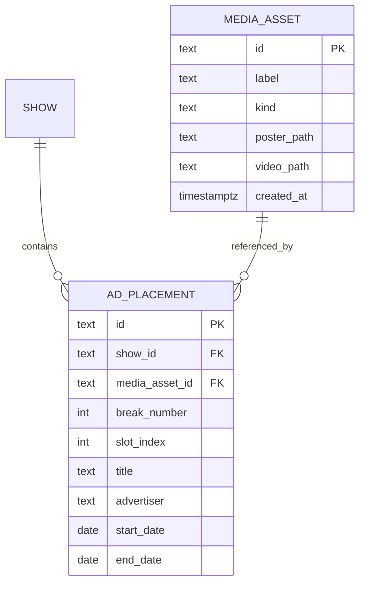

# Media i reklamy — model domeny i chmura

## Cel

Oddzielić **materiał w chmurze** od **reklamy na osi czasu** (slot w breaku, daty emisji, status pull-by). Ten sam asset może obsługiwać wiele slotów (np. ten sam kadr w break 1 i break 3), bez duplikowania uploadu.

**Nie każda reklama wymaga całego spotu w wideo** — wystarczy **screen grab / kadr (JPG)** do identyfikacji w harmonogramie i u klienta. Asset może być więc **tylko obrazem** albo **wideo + snap** (poster).

---

## Pojęcia

| Pojęcie | Opis |
|---------|------|
| **Media (asset)** | Logiczny byt w Neon + pliki w Blob. **Wymagany jest co najmniej jeden obraz** (poster / screen grab). **Preview video jest opcjonalne.** Jeden asset ≠ jeden slot. |
| **Typ assetu** | `image_only` — tylko JPG/PNG/WebP (screen grab, zrzut z playoutu, materiał od klienta). `video_and_poster` — preview MP4 **oraz** poster (poster z uploadu lub wygenerowany z wideo). |
| **Reklama (spot / placement)** | Wpis w harmonogramie: program (`show`), **break**, **slot**, tytuł, reklamodawca, czas trwania TX, daty lotu, status. Wskazuje **media przez ID**, nie „posiada” plików. Czas trwania TX (`duration_sec`) to metadane **slotu**, nie długość pliku w Blob. |
| **Frame grab / screen grab** | Statyczny kadr w listach, Gantt i miniaturach. Źródło: **samodzielny upload JPG** albo klatka wycięta z preview video. |
| **Preview video** | Opcjonalny krótki H.264 (20–30 s) do odtwarzania w adminie i portalu klienta — nie master playoutu MCR. Przy `image_only` brak playera; podgląd = powiększony obraz. |

---

## Zasada: plik mediów ≠ slot reklamy



- **Upload** tworzy lub aktualizuje `MEDIA_ASSET` w Neon + pliki w Blob.
- **Nowy slot** wybiera istniejący asset z biblioteki albo tworzy nowy — bez wymuszania nowego pliku.
- **Usunięcie reklamy** nie usuwa mediów automatycznie (media mogą być używane gdzie indziej).
- **Usunięcie mediów** możliwe tylko gdy **liczba odwołań = 0** (lub po potwierdzeniu force — opcjonalnie, poza MVP).

---

## Warianty assetu (dozwolone kombinacje)

| Wariant | Pliki w Blob | Kiedy używać |
|---------|--------------|--------------|
| **Tylko obraz** | `poster.jpg` (lub `.png`) | Stały sponsor, prosty billboard, brak pliku spotu — wystarczy screen grab z TX lub grafika od klienta. |
| **Wideo + snap** | `preview.mp4` + `poster.jpg` | Pełniejszy podgląd dla trafficu / wydawcy; poster z auto-klatki lub osobnego uploadu. |
| **Wideo + własny poster** | `preview.mp4` + `poster.jpg` (ręcznie) | Inny kadr niż domyślna klatka z MP4 (np. slajd z końcówki). |

Reguły:

- **`poster` zawsze wymagany** sensownego assetu (bez niego — placeholder `/placeholder-poster.svg` tylko jako fallback UI).
- **`preview` nigdy nie jest wymagany** — brak video nie blokuje zapisu slotu ani assetu.
- W bibliotece mediów badge typu: **Obraz** vs **Wideo + kadr**.

---

## Układ w chmurze (Vercel Blob)

### Docelowy (spójny prefiks)

```
media/{mediaAssetId}/
  poster.jpg           # wymagany (screen grab / frame grab)
  preview.mp4          # opcjonalnie — brak pliku = asset image_only
  meta.json            # opcjonalnie: kind, checksum, source filename
```

- Wszystkie pliki jednego assetu dzielą **`media/{mediaAssetId}/`** — łatwe listowanie i kasowanie (1 plik lub 2).
- Publiczne URL-e w Neon: `poster_url` (NOT NULL), `video_url` (NULL dla samych JPG).
- Pole `kind`: `image_only` \| `video_and_poster` (wyprowadzane z obecności `preview.mp4` lub ustawiane przy uploadzie).

### Stan obecny (legacy)

- Upload: `POST /api/media/upload` → `spots/{timestamp}-{filename}` — **jeden plik, losowa ścieżka**, bez powiązania z encją.
- Tabela `ads`: kolumny `frame_grab_url`, `video_url` — **URL-e sklejone ze slotem**, brak współdzielenia i biblioteki.

Migracja: istniejące URL-e można zmapować na syntetyczne `media_asset` (1:1 ze starym adem) bez natychmiastowego przenoszenia plików w Blob; nowe uploady od razu pod `media/{id}/`.

---

## Upload: JPG-only vs wideo + snap

### Zachowanie docelowe

**Ścieżka A — tylko JPG (screen grab)**

1. Admin wybiera plik obrazu (`image/jpeg`, `image/png`, `image/webp`).
2. Zapis: `media/{id}/poster.jpg`, `kind = image_only`, `video_url = NULL`.
3. UI: miniatura wszędzie z postera; modal podglądu — powiększony obraz, **bez** zakładki wideo.

**Ścieżka B — preview MP4**

1. Admin uploaduje **preview.mp4** (opcjonalnie kompresja 480p).
2. Jeśli nie dołączono osobnego JPG: przeglądarka wycina klatkę → **poster.jpg** (np. max 1280 px).
3. Jeśli dołączono JPG w tym samym kroku: ten plik = poster, video = preview.
4. UI: miniatura = poster; gdy jest video — odtwarzacz + zakładka „Frame grab”.

**Ścieżka C — tylko JPG przypięty do slotu bez nowego assetu**

1. Wybór istniejącego assetu `image_only` z biblioteki (reuse w innym breaku).

### Stan obecny (legacy)

- Upload **video** → tylko `videoUrl` na rekordzie reklamy.
- Upload **obrazu** → tylko `frameGrabUrl` (już dziś obsługa JPG w `/api/media/upload`).
- Brak encji `media_assets` i auto-postera z MP4.
- `AdPreviewModal`: przy samym posterze bez `videoUrl` — wyświetlanie obrazu (do doprecyzowania w UI docelowym: jeden spójny tryb „image only”).

---

## Biblioteka mediów (admin)

### Wymagane funkcje

| Funkcja | Opis |
|---------|------|
| **Przeglądanie** | Miniatura (poster), etykieta, **typ** (obraz / wideo+kadr), data uploadu, **ile slotów** używa. Filtry: typ assetu, wyszukiwanie po etykiecie. |
| **Podgląd** | Obraz-only: duży JPG. Wideo+kadr: player + kadr (jak dziś). |
| **Upload nowego** | **Albo** sam JPG, **albo** MP4 (± opcjonalny JPG, ± auto-poster); kompresja 480p tylko dla video. |
| **Edycja etykiety** | Np. „Acme Tours 30s — wersja A”. |
| **Usuwanie** | Usuwa wpis w Neon + pliki w Blob (`del` po pathname). **Blokada**, jeśli `reference_count > 0`, z komunikatem które sloty blokują. |
| **Wybór przy slocie** | W formularzu reklamy: „Biblioteka mediów” zamiast wyłącnie „wgraj plik”. |

### Nawigacja (propozycja UI)

- Sidebar admin: pozycja **Media** (obok Edit panel / Gantt).
- W **NewAdModal / edycja slotu**: sekcja „Materiał” → picker assetu + link „Otwórz bibliotekę”.

---

## API (docelowe)

| Metoda | Ścieżka | Opis |
|--------|---------|------|
| `GET` | `/api/media` | Lista assetów (+ `referenceCount`) |
| `GET` | `/api/media/[id]` | Szczegóły + URL-e |
| `POST` | `/api/media` | Nowy asset: **(1)** `poster` only → `image_only`; **(2)** `video` ± `poster` → `video_and_poster`; **(3)** `video` bez postera → auto-poster |
| `PATCH` | `/api/media/[id]` | Etykieta, podmiana plików |
| `DELETE` | `/api/media/[id]` | Usuń jeśli brak odwołań; kasuj prefix w Blob |
| `POST` | `/api/media/upload` | *(legacy)* — stopniowo przekierować na `POST /api/media` |

Reklamy:

| Zmiana |
|--------|
| `CommercialAd` / tabela `ads`: pole **`media_asset_id`** (FK, nullable na czas migracji). |
| Deprecate bezpośrednie `frame_grab_url` / `video_url` na slocie — resolve przez join lub widok API. |

Wszystkie mutacje mediów i slotów: **sesja admin** (jak pozostałe write API).

---

## Scenariusze użycia

### Ten sam materiał w dwóch breakach

1. Upload raz → asset `M1`.
2. Slot A (break 1, slot 2) → `media_asset_id = M1`.
3. Slot B (break 3, slot 1) → `media_asset_id = M1`.
4. Zmiana postera w bibliotece aktualizuje miniaturę **w obu** slotach.

### Wymiana materiału tylko w jednym slocie

1. Slot A zostaje na `M1`.
2. Slot B przełącza się na asset `M2` z biblioteki — bez nowego uploadu, jeśli `M2` już istnieje.

### Usunięcie „osieroconych” plików

1. Admin otwiera Media → filtr „Nieużywane (0 slotów)”.
2. Zaznacza i usuwa — Blob + wiersz w `media_assets`.

### Reklama tylko ze screen grabbem (bez spotu)

1. Klient wysyła JPG z air checku; admin zakłada asset **Obraz** i slot z `duration_sec` ręcznie (np. 30 s TX).
2. Ten sam JPG przypisany do slotów w break 1 i 2 — jeden upload, dwa placementy.
3. Portal klienta pokazuje miniaturę; brak przycisku play — to oczekiwane.

---

## Bezpieczeństwo i limity

- Limit rozmiaru uploadu: **80 MB** (jak dziś) — dotyczy preview, nie masterów playoutu.
- Typy: `video/*`, `image/*` (w tym **JPEG** jako domyślny screen grab), `.mp4`, `.jpg`/`.jpeg`, `.png`, `.webp`.
- Dla **image_only** typowy rozmiar pliku mały (np. limit 10–15 MB opcjonalnie w UI — globalny limit 80 MB nadal dla dużych PNG); w MVP jeden limit 80 MB jak dziś.
- Usuwanie z Blob wymaga tokena `BLOB_READ_WRITE_TOKEN`; operacje list/delete przez `@vercel/blob`.
- Klient `/client` **tylko odczyt** URL-i mediów powiązanych ze slotami widocznymi w linku — bez biblioteki i bez delete.

---

## Powiązanie z resztą produktu

- **Status reklamy** (`computeAdStatus`, pull-by): bez zmian — dotyczy slotu, nie assetu.
- **Portal klienta**: miniatury zawsze z postera; **play tylko gdy** asset ma `video_url`.
- **MCR / cue sheet**: metadane slotu (tytuł, czas TX, daty); opcjonalnie w przyszłości osobne pole „ID materiału playout” poza preview w Blob.

---

## Kolejność wdrożenia (rekomendacja)

1. Schema `media_assets` (`kind`, `poster_url`, nullable `video_url`) + API CRUD + list/delete Blob pod `media/{id}/`.
2. Upload **JPG-only** i **MP4±poster**; auto-poster z preview gdy brak JPG.
3. UI biblioteki mediów (browse + delete z blokadą referencji).
4. `media_asset_id` na `ads` + picker w formularzu slotu.
5. Migracja legacy URL-i; deprecacja pól URL na `ads`.

Szczegóły checklisty: [stan-implementacji.md](./stan-implementacji.md).
